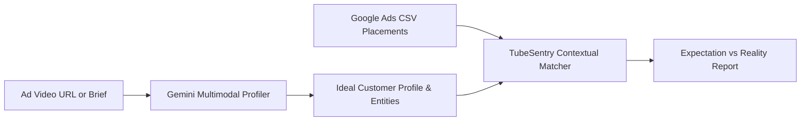

# Gemini Creative Targeting Fit Engine

Modern media buyers spend thousands producing bespoke video ads tailored to specific audiences, only to discover that Google's automated bidding delivers the bulk of impressions to unrelated channels.

TubeSentry's **Creative Targeting Engine** bridges the gap between **Creative Brief** and **Delivery Reality**.

---

## How It Works



1. **Creative Profiling:** Gemini analyzes your ad URL or copy to infer:
   * **Target Persona (ICP):** Roles, seniority, and purchasing mindset.
   * **Target Intent:** Core value proposition and conversion goal.
   * **Recommended Contextual Topics:** YouTube Knowledge Graph / Wikipedia entities (e.g. *Cloud computing*, *DevOps*, *Computer security*).
   * **Negative Anti-Personas:** Categories to strictly exclude (*Toddlers*, *Underage Gaming*, *Sleep Music*).
2. **Contextual Delta Matching:** Evaluates every placement row in your report:
   * **On-Target:** Clean channel matching target topic entities or keywords.
   * **Neutral:** Clean channel without strict topic overlap.
   * **Off-Target:** Waste channel or negative anti-persona collision.
3. **Alignment Scoring (1–10):**
   $$\text{Score} = \frac{(\text{On-Target Spend} \times 10) + (\text{Neutral Spend} \times 5) + (\text{Off-Target Spend} \times 0.5)}{\text{Total Spend}}$$

---

## Executive "Expectation vs. Reality" Report

In the compiled CFO deck, TubeSentry outputs a side-by-side contrast:

| Dimension | Creative Expectation | Delivery Reality | Status |
| :--- | :--- | :--- | :--- |
| **Target Audience** | Enterprise DevOps & SRE Architects | 59.5% spend delivered to Toddlers and Lo-Fi listeners | 🚨 Critical Bleed |
| **Contextual Environment** | Cloud computing, software architecture | Majority impressions in nursery rhymes and gaming | 🚨 Critical Bleed |
| **Viewer Mindset** | Active desktop evaluation with sound on | Passive iPad / background tab playback | ⚠️ Misaligned |
| **Brand Safety** | Adult enterprise brand safety | COPPA Made-for-Kids channels exposed | 🚨 Critical Bleed |

---

## Using via CLI

```bash
tubesentry audit report.csv \
  --ad-url "https://youtube.com/watch?v=demo_video" \
  --ad-text "ApexCloud automated Kubernetes cluster orchestration platform for enterprise SRE teams." \
  --html cfo_deck.html
```
